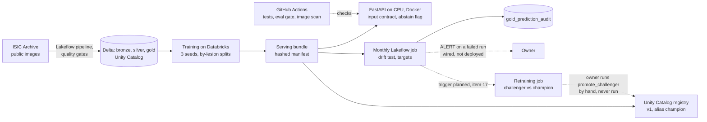

# Architecture

One page: what runs where, how it scales, and where it breaks. Every number is from a committed
file named beside it. A research prototype, **not for clinical use**. Dashed lines are planned
or hand-run steps, not automated ones.

## What runs where

- **Databricks Free Edition (serverless, $0):** the data pipeline (Delta tables, data-quality
  gates that fail the update), training, the serving bundle, the registry and the monthly drift
  job. The retraining loop ran once, by hand, and did not promote; its alert trigger, the bundle
  rebuild and the registry move are not built (`docs/BACKLOG.md` item 17). Job results are
  logged as MLflow runs by hand (`results/mlflow_runs.json`; a test checks logged files are not
  stale, not that every file is logged), and DBUs are in `results/phase3/costs/result_costs.json`
  where billing reached the table.
- **The API (`app/api`):** FastAPI and PyTorch on CPU in a Docker image, loading the bundle file
  (not through the registry). CI builds and scans it on every push. Not deployed.
- **GitHub Actions:** ruff, mypy, pytest, the eval gate (committed metrics against
  `config/eval_gate.json`; it reads files and runs no model), secret scanning, the image scan.

## How it scales

- **Data:** 27,656 images, five datasets from six hospitals
  (`results/phase2/v2/data_checks.json`). The monthly job replays 300 images a month
  (`results/phase3/monthly/spec.json`).
- **Serving (item 13, `results/phase3/serving/benchmark.json`):** with an untrained one-network
  test bundle, no Docker and a CUDA torch build on a 4-CPU shared VM, the API serves about 44 to
  53 requests a second from 1 to 20 users while median latency grows from 18.4 ms to 458.6 ms.
  Throughput is flat from one user, so the machine is likely saturated already (CPU use was not
  measured). That is serving speed only, not the shipped model.
- **The shipped model runs three networks per image:** the ensemble's PyTorch median is
  288.6 ms per image at batch size 1 on Databricks serverless CPU
  (`results/phase3/onnx/results.json`). The benchmark's 18 ms per whole request on other
  hardware is about 5 times faster per network; the gap is not explained. The champion's
  throughput needs its bundle as a release asset (item 6).
- **Not measured yet:** batch scoring at scale (item 14; the owner chose a 5,000-image slice
  first) and detector quality on staged shifts (item 15; approved, code and spec committed,
  waiting for the champion bundle as a release asset).

## Where it breaks

1. **CPU saturation.** Latency grows in step with concurrent users from the first one
   (item 13). Likely levers, not measured: more processes with fewer threads each, or a
   lighter model. ONNX failed its parity check (`results/phase3/onnx/results.json`).
2. **Drift scores depend on hardware.** Scores recomputed on CPU differed from the GPU fit, so
   the baseline and every monitored month are scored on the same hardware
   (`docs/model-card.md`, section 5).
3. **Labels arrive late.** The melanoma target needs each labelled month's referral count; it
   reads "insufficient data" in all 12 replay months until they are backfilled, and no labels
   arrive after the replay (`results/phase3/monthly/slo_replay.json`, `config/slo.json`).
4. **Skin type is recorded only at the new sites,** so a per-skin-type alert also measures the
   site shift (`results/phase3/monthly/`).
5. **Free Edition limits:** serverless only, with restricted outbound access. Archive-scale
   batch scoring (an estimate, not a measurement: about 130 GB of images for 50,000, item 14)
   may meet limits whose size is unknown.
6. **The detector is one score.** An alert says the month looks unlike validation, not why;
   the response is a human look and, with labels, retraining.
