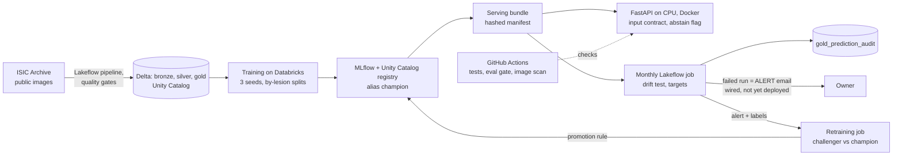

# Architecture

One page: what runs where, how it scales, and where it breaks. Every number is from a committed
results file named beside it. A research prototype, **not for clinical use**.

## What runs where

- **Databricks Free Edition (serverless, $0):** the data pipeline (Delta tables, data-quality
  gates that fail the update), training, the registry, the monthly drift job and the
  retraining job. Every result file that a job wrote is logged as an MLflow run
  (`results/mlflow_runs.json`), and its DBUs are in `results/phase3/costs/result_costs.json`
  where billing reached the table.
- **The API (`app/api`):** FastAPI and PyTorch on CPU in a Docker image. CI builds it on every
  push and scans it (Trivy). It is not deployed.
- **GitHub Actions:** ruff, mypy, pytest, the eval gate (committed metrics against floors in
  `config/eval_gate.json`; it reads files, it runs no model), secret scanning and the image
  scan.

## How it scales

- **Data:** 27,656 ISIC images across six sources (README, Phase 2). The monthly job replays
  300 images a month (`results/phase3/monthly/spec.json`).
- **Serving (item 13, `results/phase3/serving/benchmark.json`):** with an untrained one-network
  test bundle on a 4-CPU shared VM, the API serves about 44 to 53 requests a second from 1 to
  20 concurrent users, while median latency grows from 18.4 ms to 458.6 ms. The machine is
  saturated: requests compute in parallel threads and compete for the CPUs. That is serving
  speed only, not the shipped model.
- **The shipped model runs three networks per image.** On Databricks serverless CPU, PyTorch
  took a median of about 93 ms per network per image at batch size 1
  (`results/phase3/onnx/results.json`), so roughly 0.3 s of compute per image for the
  ensemble before any parallelism. The champion's own throughput is not measured: it needs
  the bundle as a release asset (item 6).
- **Batch scoring at scale (item 14)** and **detector quality on staged shifts (item 15)** are
  not measured yet. Item 15 has a spec committed before any run
  (`results/phase3/detector_quality/spec.json`). Both runs wait on the owner's approval.

## Where it breaks

1. **CPU saturation.** Past a few concurrent users, latency grows in step with load (item 13).
   The likely levers are more processes with fewer threads each, or a lighter model. They are
   not measured, and ONNX failed its parity check (Phase 3).
2. **Drift scores depend on hardware.** Mahalanobis scores recomputed on CPU differed from the
   GPU fit, so the baseline and every monitored month are scored on the same hardware
   (`docs/model-card.md`, section 5).
3. **Labels arrive late.** The melanoma and accuracy targets need labelled months. After the
   replay no labels arrive, so those targets report "insufficient data" (`config/slo.json`).
4. **Skin type is recorded only at the new sites,** so a per-skin-type alert also measures the
   site shift (`results/phase3/monthly/`).
5. **Free Edition limits:** serverless only, with restricted outbound access. Batch scoring at
   archive scale (an estimate, not a measurement: about 130 GB of images for 50,000, item 14)
   may meet limits whose size is unknown.
6. **The detector is one score.** An alert says the month looks unlike validation, not why;
   the response is the runbook and a human look, and retraining needs labels.
